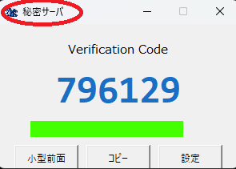
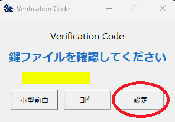
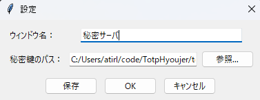

# TotpHyoujer
テキスト形式の秘密鍵からTotpコードを表示するGUIツール

## 概要
テキストファイル（Base32形式の秘密鍵）を読み込んで、30秒ごとに6桁のコードを生成します。オフライン動作（ローカル時刻で生成）します。  
   
_読み方：てぃーおーてぃーぴーひょうじゃー_

## 準備
ログインに使用するQRコードを用意し、秘密鍵をテキスト化してください(下部参照)。   
テキスト化はQRコードをwebツールにアップロードしても変換可能ですが、秘密鍵ファイルですので、QrDecoderなどオフラインでの変換を推奨します。   
[QrDecoderはこちら](https://github.com/atirl/QrDecoder)

## 起動方法
__exe実行の場合__  
releaseから最新版zipをダウンロード・解凍して、exeファイルを実行してください。

__Python実行の場合__  
必要ライブラリをインストールし、TotpHyoujer.pyを実行してください
```powershell
python -m pip install pyotp pyperclip 
python TotpHyoujer.py
```

## 作成経緯
Totp認証ツールと言えばQRコードが標準となっています。  
ある職場では、QRコードを人に渡したり見える位置に保存していたりして「鍵」だと意識していない人も多いみたいなので、Base32テキストを「これは鍵ファイルだから外部に漏れないように！」と言って渡したところ慎重に保管してくれたので、テキストの方が良いこともあるんだな、とかなんとか。

## QRコードから秘密鍵を抜き出し
QrDecoderに秘密鍵の入ったQRコードをドラッグ＆ドロップすると、下記のようなテキストが出力されます。(英字A～Zと数字2～7の文字列)
```
AAAABBBB234567
```
他の人が使う可能性のあるPCであれば、保存先は   
```
C:\Users\ユーザー名\key
```
など、ユーザーフォルダ内に保存することをおススメします。  
Dドライブ直下など、他の人がアクセスしそうなところには置かないでください。

## 画面説明
詳しくは[マニュアル](https://atirl.github.io/TotpHyoujer/manual.html)を参照してください。

   
初期状態では鍵ファイルが設定されていないので[設定]ボタンから設定してください。

   
ウインドウ名と、事前に準備した秘密鍵ファイルを指定して、保存（設定を保存したくない場合はOK）ください。

   
ウインドウタイトルが変わって、秘密鍵に応じたTotpコードが表示されていれば設定完了です。